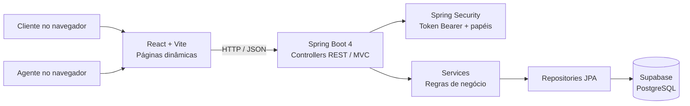

# 🚗 Rota — Sistema de Aluguel de Carros

Aplicação web para cadastrar clientes e acompanhar pedidos de aluguel de automóveis, da solicitação à avaliação financeira e execução do contrato.


---

## 📚 Índice

- [Links úteis](#-links-úteis)
- [Sobre o projeto](#-sobre-o-projeto)
- [Funcionalidades](#-funcionalidades-principais)
- [Tecnologias](#-tecnologias-utilizadas)
- [Arquitetura](#-arquitetura)
- [Instalação e execução](#-instalação-e-execução)
- [Deploy](#-deploy)
- [Estrutura de pastas](#-estrutura-de-pastas)
- [Demonstração](#-demonstração)
- [Testes](#-testes)
- [Documentação](#-documentações-utilizadas)
- [Autores](#-autores)
- [Contribuição](#-contribuição)
- [Agradecimentos](#-agradecimentos)
- [Licença](#-licença)

## 🔗 Links úteis

- [Template de README utilizado](https://github.com/joaopauloaramuni/desenvolvimento-e-integracao-de-aplicacoes-web/blob/main/TEMPLATES/template_README.md)
- [Modelos UML e histórias do usuário](docs/modelos/)
- Demonstração on-line: ainda não publicada.

## 📝 Sobre o projeto

O Rota é um protótipo acadêmico para apoiar a gestão de pedidos de aluguel de automóveis pela Internet. Clientes autenticados mantêm seus dados e criam, consultam, modificam ou cancelam pedidos. Agentes de empresas e bancos analisam os pedidos, registram pareceres e encaminham pedidos favoráveis para execução do contrato.

O cadastro do cliente registra RG, CPF, nome, endereço, profissão e até três vínculos empregatícios com seus rendimentos. O pedido registra os dados do automóvel — matrícula, ano, marca, modelo e placa — e o período pretendido. O contrato registra se o automóvel pertence ao cliente, à empresa ou ao banco. Um contrato de crédito concedido por banco agente pode ser associado ao aluguel.

O sistema contém dois subsistemas: gestão de pedidos e contratos no back-end; e construção dinâmica das páginas web no front-end.

## ✨ Funcionalidades principais

- 🔐 Cadastro e login com usuário e senha para clientes e agentes.
- 👤 CRUD do perfil do cliente, incluindo dados pessoais, profissão e até três vínculos de renda. A exclusão desativa o cadastro e encerra as sessões.
- 📝 Criação, consulta, edição e cancelamento de pedidos pelo cliente. A edição fica disponível enquanto o pedido aguarda análise.
- 🚘 Registro dos dados do automóvel e período desejado no pedido.
- 📊 Fila de pedidos para agentes, com início de análise, edição dos dados e parecer financeiro favorável ou desfavorável.
- 📄 Execução de contrato após parecer favorável, com indicação do tipo e nome do proprietário do automóvel.
- 🏦 Associação opcional de crédito concedido por agente bancário.
- 💬 Assistente conversacional para dúvidas sobre a frota e o fluxo de aluguel, conectado a um provedor compatível com a API OpenAI.
- 🔒 Controle de acesso por papel: clientes acessam seus próprios dados e pedidos; operações de análise e contrato são restritas a agentes.

### Situações do pedido

`PENDENTE_ANALISE` → `EM_ANALISE` → `AGUARDANDO_EXECUCAO` ou `REPROVADO` → `CONTRATO_EXECUTADO`

O cliente pode cancelar pedidos que ainda não tiveram o contrato executado, passando o estado para `CANCELADO`. Um parecer positivo coloca o pedido em `AGUARDANDO_EXECUCAO`; a execução cria o contrato e atualiza o pedido.

## 🛠 Tecnologias utilizadas

### Front-end

- React 19 e JavaScript.
- Vite 7 para desenvolvimento e build.
- CSS responsivo sem biblioteca adicional de componentes.
- API HTTP/JSON; token Bearer mantido em `sessionStorage` no navegador.

### Back-end

- Java JDK 25.
- Spring Boot 4.0.9 e Spring MVC em API REST.
- Apache Maven.
- Spring Data JPA / Hibernate e PostgreSQL Driver.
- Spring Security, senha com BCrypt e tokens de sessão Bearer aleatórios.
- Bean Validation para validar os dados recebidos pela API.

### Banco e infraestrutura

- Supabase PostgreSQL.
- Git e GitHub para versionamento.
- Hospedagem e pipeline de deploy ainda não definidos.

## 🏗 Arquitetura

O front-end React/Vite consome a API REST do Spring Boot. Os controllers recebem e validam as requisições; os services aplicam regras de negócio; repositories e entidades JPA persistem os dados no PostgreSQL do Supabase. O navegador não acessa o banco diretamente.



Os modelos de casos de uso, histórias, classes e pacotes estão versionados em [`docs/modelos/`](docs/modelos/). A modelagem atual corresponde à versão inicial do protótipo e deve ser atualizada junto com mudanças de requisitos ou código.

### Endpoints principais

| Método | Rota | Acesso |
|---|---|---|
| `POST` | `/api/auth/register` | Público — cadastro de cliente |
| `POST` | `/api/auth/register-agent` | Público, exige código de convite configurado no back-end |
| `POST` | `/api/auth/login` | Público — login |
| `GET` | `/api/auth/me` | Autenticado — usuário atual |
| `POST` | `/api/auth/logout` | Autenticado — encerra sessão |
| `GET`, `PUT`, `DELETE` | `/api/client/profile` | Cliente — consultar, atualizar e desativar perfil |
| `GET`, `POST` | `/api/requests` | Cliente — listar e criar pedidos próprios |
| `PUT`, `DELETE` | `/api/requests/{id}` | Cliente — alterar ou cancelar pedido próprio |
| `GET` | `/api/agent/requests` | Agente — fila de análise |
| `PATCH` | `/api/agent/requests/{id}/start-analysis` | Agente — iniciar análise |
| `PUT` | `/api/agent/requests/{id}` | Agente — atualizar dados durante a análise |
| `POST` | `/api/agent/requests/{id}/assessment` | Agente — registrar parecer |
| `POST` | `/api/agent/requests/{id}/execute` | Agente — executar contrato aprovado |
| `GET` | `/api/contracts/requests/{requestId}` | Cliente proprietário do pedido ou agente |

## 🔧 Instalação e execução

### Pré-requisitos

- Docker em execução, Supabase CLI, Java JDK 25 e Apache Maven 3.6.3 ou superior.
- Node.js 20.19+ ou 22.12+ e npm.

### Inicialize o projeto local

Se quiser definir outra senha PostgreSQL local antes de criar o banco, copie o exemplo e edite `SUPABASE_LOCAL_DB_PASSWORD`:

```bash
cp .env.example .env
```

Na raiz do repositório, inicie a aplicação:

```bash
./start.sh
```

O script inicia o Supabase local, aplica as migrations SQL do projeto e inicia a API e o front-end. O banco local usa o nome e o usuário `postgres`. Se `.env` não existir, `start.sh` o cria a partir de [`.env.example`](.env.example) com os valores locais padrão. As tabelas e relacionamentos da migration refletem as entidades JPA; `SPRING_JPA_DDL_AUTO=validate` faz a API conferir o schema ao iniciar. Depois de criar o banco, mudar a senha no `.env` também exige atualizar a senha do usuário `postgres` no próprio banco.

Endereços locais:

- API: `http://localhost:8088` (`GET /api/health` para verificar)
- Front-end: `http://localhost:5173`
- Supabase Studio: `http://127.0.0.1:54323`

O Supabase local mantém os dados no volume do Docker entre inicializações. O `start.sh` está configurado para o Supabase local. Para conectar a API a um projeto hospedado, configure as variáveis JDBC na execução da API e aplique a migration ao projeto; não publique credenciais nem chaves administrativas.

### Revisar e compartilhar somente o catálogo de carros

O catálogo público é versionado em `supabase/migrations/20261106000001_add_car_catalog.sql`. Cadastros criados durante o uso ficam no volume PostgreSQL local e não são exportados pelas migrations. O `.gitignore` também exclui `.env`, logs, dumps e arquivos temporários do Supabase.

Antes de commitar, revise os arquivos pendentes com:

```bash
./scripts/check-github-safe.sh
```

O verificador bloqueia configurações locais, dumps, logs, CSVs fora do formato do catálogo e comandos SQL que gravem contas, clientes, agentes ou pedidos. Para instalar essa verificação automaticamente antes de cada commit, execute uma vez:

```bash
./scripts/install-git-hooks.sh
```

Para inspecionar o CSV do catálogo disponível no banco local sem exportar usuários ou pedidos:

```bash
./supabase/export-cars.sh
```

O exportador escreve somente os campos públicos dos carros disponíveis em CSV no terminal. Para salvar um arquivo, informe `--output caminho/arquivo.csv`; revise-o antes de adicioná-lo ao Git.

### 3. Acesso de cliente e agente

1. Crie uma conta na opção **Cliente** ou entre com uma conta já existente.
2. Para criar um agente, selecione **Agente** na tela de cadastro e informe o código definido em `AGENT_INVITE_CODE` no back-end. Selecione empresa ou banco.
3. Clientes criam pedidos na página **Meus pedidos**. Agentes usam a fila **Pedidos** para iniciar análise, registrar parecer e executar contratos.
4. O item **Conversar com agente** abre o assistente virtual, que responde sobre a frota e o funcionamento do sistema.

## 🔑 Variáveis de ambiente

| Variável | Onde | Descrição |
|---|---|---|
| `SUPABASE_DB_NAME` | Raiz | Banco local; o Supabase local usa `postgres` |
| `SUPABASE_DB_USER` | Raiz | Usuário local; o Supabase local usa `postgres` |
| `SUPABASE_LOCAL_DB_PASSWORD` | Raiz | Senha PostgreSQL local usada pelo Supabase e pelo back-end |
| `SERVER_PORT` | Back-end | Porta HTTP da API; padrão `8088` |
| `SPRING_DATASOURCE_URL` | Back-end | URL JDBC do PostgreSQL/Supabase |
| `SPRING_JPA_DDL_AUTO` | Back-end | Estratégia de schema JPA; o exemplo local usa `validate` |
| `AGENT_INVITE_CODE` | Back-end | Código necessário para cadastrar agentes |
| `SESSION_HOURS` | Back-end | Validade de sessão em horas; padrão `12` |
| `CORS_ALLOWED_ORIGIN` | Back-end | Origem autorizada; padrão `http://localhost:5173` |
| `VITE_API_URL` | Front-end | URL base da API; padrão `http://localhost:8088/api` |
| `OPENAI_API_KEY` | Back-end | Chave da API Maritaca; aliases aceitos: `MARITACA_API_KEY` ou `APIKEY`; não é enviada ao navegador |
| `OPENAI_BASE_URL` | Back-end | URL base OpenAI-compatible; padrão `https://chat.maritaca.ai/api` |
| `OPENAI_MODEL` | Back-end | Modelo de chat; padrão `sabiazinho-4` |
| `OPENAI_MAX_TOKENS` | Back-end | Limite de saída do assistente; padrão `900` |

O `start.sh` deriva `SPRING_DATASOURCE_USERNAME` e `SPRING_DATASOURCE_PASSWORD` das variáveis do banco local.
Defina `OPENAI_API_KEY` no `.env` da raiz para habilitar o assistente. O app usa Chat Completions no back-end, envia ao provedor somente o histórico digitado e os dados públicos dos veículos e não registra a chave nos logs. Sem chave, o restante do sistema continua funcionando e o endpoint de conversa informa que falta configuração.

## 🚀 Deploy

Ainda não há provedor de hospedagem configurado. Para publicar, disponibilize a API Spring Boot e os arquivos estáticos do Vite, configure as variáveis de ambiente no provedor e use HTTPS. O Supabase deve permanecer acessível apenas por meio do back-end.

Builds previstos:

```bash
cd frontend && npm run build
cd ../backend && mvn clean package
```

> **Limitação atual:** tokens de sessão são guardados em memória no processo da API e expiram após o período configurado. Reiniciar ou escalar horizontalmente o servidor encerra sessões; uma implantação real deve adotar armazenamento compartilhado ou um mecanismo de identidade apropriado.

## 📂 Estrutura de pastas

```text
.
├── .env.example
├── README.md
├── start.sh
├── supabase/
│   ├── config.toml
│   └── migrations/               # Schema PostgreSQL alinhado às entidades JPA
├── docs/
│   └── modelos/
│       └── v1.0/                 # Casos de uso, histórias, classes e pacotes
├── frontend/
│   ├── .env.example
│   ├── index.html
│   ├── public/rota-symbol.svg
│   ├── package.json
│   └── src/                      # React, integração HTTP e estilos
└── backend/
    ├── .env.example
    ├── pom.xml
    └── src/main/
        ├── java/br/edu/lab2/carros/
        │   ├── api/              # Controllers, DTOs e tratamento de erros
        │   ├── config/           # Segurança e CORS
        │   ├── domain/           # Entidades e enums
        │   ├── repository/       # Persistência JPA
        │   ├── security/         # Sessões Bearer
        │   └── service/          # Regras de negócio
        └── resources/application.properties
```

## 🎥 Demonstração

O protótipo possui telas de autenticação/cadastro, visão geral, perfil do cliente, criação e acompanhamento de pedidos e fila de análise para agentes. Capturas e link de demonstração serão adicionados quando o grupo publicar o ambiente.

## 🧪 Testes

Não há suíte automatizada adicionada nesta versão. Os fluxos de autenticação, cadastro, pedidos e contratos ainda precisam de cobertura unitária, integração com PostgreSQL e ponta a ponta.

## 🔗 Documentações utilizadas

- [Template de README da disciplina](https://github.com/joaopauloaramuni/desenvolvimento-e-integracao-de-aplicacoes-web/blob/main/TEMPLATES/template_README.md)
- [Requisitos de sistema do Spring Boot 4.0](https://docs.spring.io/spring-boot/4.0/system-requirements.html)
- [Referência do Spring Boot 4.0](https://docs.spring.io/spring-boot/4.0/reference/index.html)
- [Documentação do Java](https://docs.oracle.com/en/java/)
- [Documentação do Apache Maven](https://maven.apache.org/guides/)
- [Documentação do React](https://react.dev/)
- [Guia do Vite](https://vite.dev/guide/)
- [Documentação do Supabase](https://supabase.com/docs)
- [Documentação do PostgreSQL](https://www.postgresql.org/docs/)

## 👥 Autores

Adicionar os nomes e perfis dos integrantes do grupo.

## 🤝 Contribuição

1. Crie uma branch para sua alteração.
2. Faça commits com mensagens objetivas.
3. Atualize os modelos em `docs/modelos/` quando uma mudança afetar requisitos, regras ou arquitetura.
4. Revise o alinhamento entre modelo, código e documentação antes de integrar a alteração.

## 🙏 Agradecimentos

À disciplina e aos docentes responsáveis pela orientação do laboratório. Completar com as referências acadêmicas do grupo.

## 📄 Licença

Licença ainda não definida para este projeto acadêmico.
