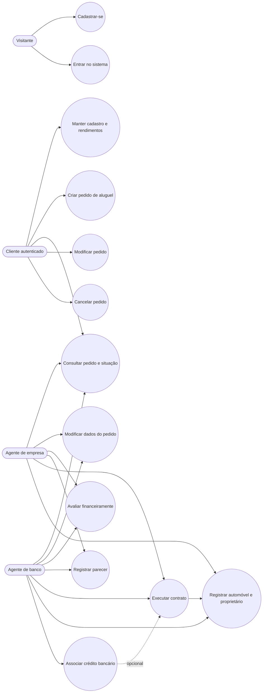

# Diagrama de casos de uso — v1.0

**Atores:** visitante, cliente autenticado, agente de empresa e agente de banco. As ações de negócio exigem autenticação; o visitante só pode cadastrar-se ou iniciar o login.
