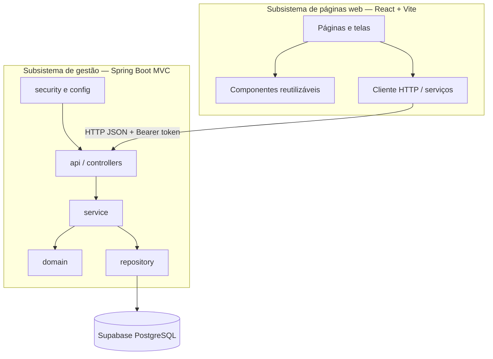

# Diagrama de pacotes — visão lógica v1.0

Controllers validam a entrada HTTP; services concentram as regras; entidades representam o domínio; repositories persistem no PostgreSQL do Supabase. O front-end não acessa o banco diretamente.
